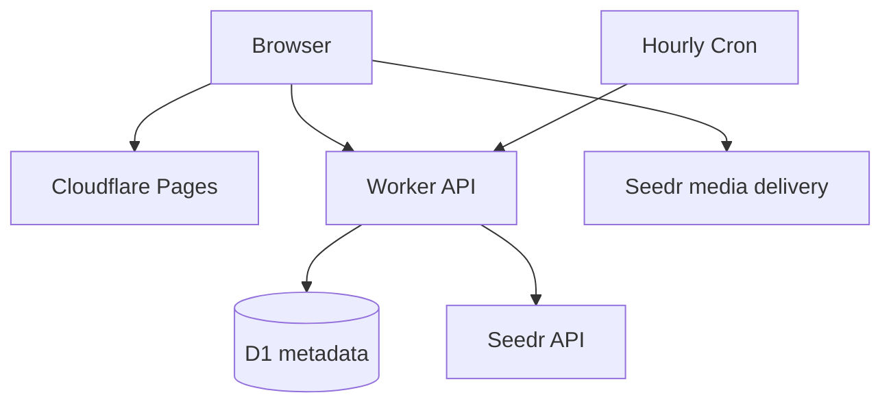

<div align="center">


# LinkBox

**Temporary shared downloads, built for the browser.**


[Open LinkBox](https://linkbox-repo.pages.dev) · [Quick start](#quick-start) · [Architecture](#architecture) · [Operations](#operations-and-deployment)

</div>

---

A mobile-first app for submitting magnets, following download progress, browsing files, and playing or downloading supported media. **Seedr holds the files; Cloudflare holds the interface, API, and metadata.** Only content created through LinkBox is shared and cleanup-managed.

## ✨ Features

| Capability | Behavior |
|---|---|
| 🧲 Submit and track | Magnet validation, queued progress, bounded submissions, and clear failure states |
| 📂 Browse and download | Folder navigation, supported previews, and direct file delivery |
| ▶️ Play media | HLS/native playback when available; external-player links for compatible devices |
| ⏳ Temporary sharing | Creator deletion anytime, deletion by others after 3 hours, and expiry due after 24 hours |
| ☁️ Capacity | Actual connected Seedr quotas; every item must fit within one account |
| 🔐 Owner controls | Separate admin-key protection for account configuration |
| 📱 PWA | Installable cached shell; file operations and playback require connectivity |

<a id="architecture"></a>

## 🧱 Architecture



Media is delivered directly from Seedr. No media files are stored in Workers, D1, GitHub, or R2. Supabase is not used by the current runtime.

<a id="quick-start"></a>

## 🚀 Quick start

Requirements: **Node.js 22.13+** with `node:sqlite` support and npm; the Pages build is configured for Node 24. The checked-in local Worker defaults to **mock mode**.

```bash
git clone https://github.com/Vignesh-S-GitHub/linkbox_repo.git
cd linkbox_repo
npm ci
npm run db:migrate:local
npm run dev
```

Open **http://localhost:5173** · Worker API: **http://localhost:8787**.

Mock mode requires no provider credentials and uses synthetic in-memory files and metadata, reset on restart. It does not prove real provider download or media delivery. Live mode uses the local D1 state under `apps/worker/.wrangler/state`; the local migration command does not touch production.

## 🔑 Connect a live account

From a Windows PowerShell terminal:

```powershell
npm run seedr:check
npm run seedr:configure
```

The private setup helper verifies quota and writes the token to ignored `apps/worker/.dev.vars`. Restart development afterward. Other environments can follow the configuration fields in [Seedr setup](SEEDR_LOCAL_SETUP.md); the npm convenience commands use PowerShell.

| Setting | Role |
|---|---|
| `SEEDR_MODE` | `mock` or `live` |
| `SEEDR_ACCESS` | `full`; `storage-only` disables writes and cleanup |
| `SEEDR_ACCOUNT_CONFIG` | Internal account metadata and secret-name references |
| `SEEDR_ACCOUNT_A_TOKEN` | Private provider token in Worker secrets/local ignored vars |
| `DB` | D1 binding, configured in Wrangler |
| `ALLOWED_ORIGIN` | Exact frontend origin |
| `VITE_API_URL` | Public Worker URL; never a provider token |

[.env.example](.env.example) documents the sanitized settings. Required provider scopes are `account.read`, `files.read`, `files.write`, `tasks.read`, `tasks.write`, and `media.read`. Keep the actual token out of source and frontend variables.

## ⏳ Lifetime and deletion

- A browser-local private identifier recognizes the creator; it is not an account login or cross-device identity.
- The creator may delete immediately. Other visitors wait **3 hours**, then use the confirmed Delete action.
- At **24 hours**, delivery is blocked and cleanup becomes due. Hourly Cron handles bounded batches; outages or backlogs can delay physical deletion.
- Items cannot span accounts, even if combined free capacity is sufficient. Unknown-size magnets cannot be guaranteed to fit before metadata resolves.
- Cleanup checks ownership and is limited to app-managed files/tasks. Existing personal Seedr folders are not imported.

Keep disabled accounts and their token bindings configured until their existing files are cleaned up. `storage-only` mode disables Cron deletion too.

## 🔐 Owner account management

**Settings → Accounts** requires a separate high-entropy admin key. The raw key stays in browser memory and the Worker stores its hash as `LINKBOX_ADMIN_KEY_SHA256`.

```powershell
npm run admin:setup
# For the deployed Worker:
npm run admin:setup:production
```

For another account, create a different Worker secret name for that account's token, then verify/connect its secret reference in the owner UI. Do not register a second token for the same provider account: it can double-count capacity. See [production review](PRODUCTION_REVIEW.md) and [local testing](LOCAL_TESTING.md).

<a id="operations-and-deployment"></a>

## 🌐 Operations and deployment

| Component | Configuration |
|---|---|
| Pages | Build `npm run build --workspace=@temporary-share/web`; output `apps/web/dist` |
| Public API URL | `VITE_API_URL` must match the Worker hostname |
| Worker | [apps/worker/wrangler.toml](apps/worker/wrangler.toml), production environment |
| D1 | `linkbox-metadata`, binding `DB`; migrations under `apps/worker/migrations/` |
| Cleanup | Hourly `0 * * * *` Cron; active only with live full access |

For an existing configured account, apply pending migrations before a Worker release:

```bash
npm run db:migrate:remote
cd apps/worker
npx wrangler secret put SEEDR_ACCOUNT_A_TOKEN --env production
npx wrangler deploy --env production
```

For a new Cloudflare account, create your own D1 database and replace the account/database IDs in **both** Wrangler environments first. Keep Worker `ALLOWED_ORIGIN`, frontend `VITE_API_URL`, and `apps/web/public/_headers` CSP in agreement. Pages deployment does not deploy the Worker.

## 🧪 Development checks

```bash
npm run lint
npm run typecheck
npm test
npm run build
```

[quality.yml](.github/workflows/quality.yml) runs the configured quality checks. Tests include mock behavior and real SQLite execution of D1 schema/queries; provider-dependent delivery still needs a live-account check. [V1 verification](V1_VERIFICATION.md) and [production review](PRODUCTION_REVIEW.md) record the tested scope and limits.

## 📱 Offline use and troubleshooting

Only the public app shell and brand assets are cached. API responses, signed delivery URLs, file lists, and media are not cached; an offline cold launch is not a file backup. Updates wait until windows close or you explicitly reload.

| Symptom | Check |
|---|---|
| D1 unavailable locally | Run local migrations, check `DB`, and restart |
| Live quota but no files | Personal files are intentionally not imported; check access mode |
| Item cannot fit | Check a single account's available capacity |
| Unconfirmed submission/deletion | Inspect Files before retrying; writes are not automatically retried |
| Old item awaiting removal | Check full access, hourly Cron, account secrets, and provider availability |

## 📁 Repository guide

[apps/web/](apps/web/) — frontend and branding · [apps/worker/](apps/worker/) — API, D1, provider adapters, and cleanup · [packages/shared/](packages/shared/) — public types · [scripts/](scripts/) — private setup and regression helpers.

Use only content you are entitled to download and share. Provider eligibility, storage capacity, and Cloudflare quotas apply independently; this architecture does not guarantee unlimited free service.

## 🤝 Contributing

Open an issue with a reproducible example or submit a focused pull request. Keep setup instructions and documentation aligned with any behavior changes.

## 📄 License

No repository-level `LICENSE` file is currently included.
